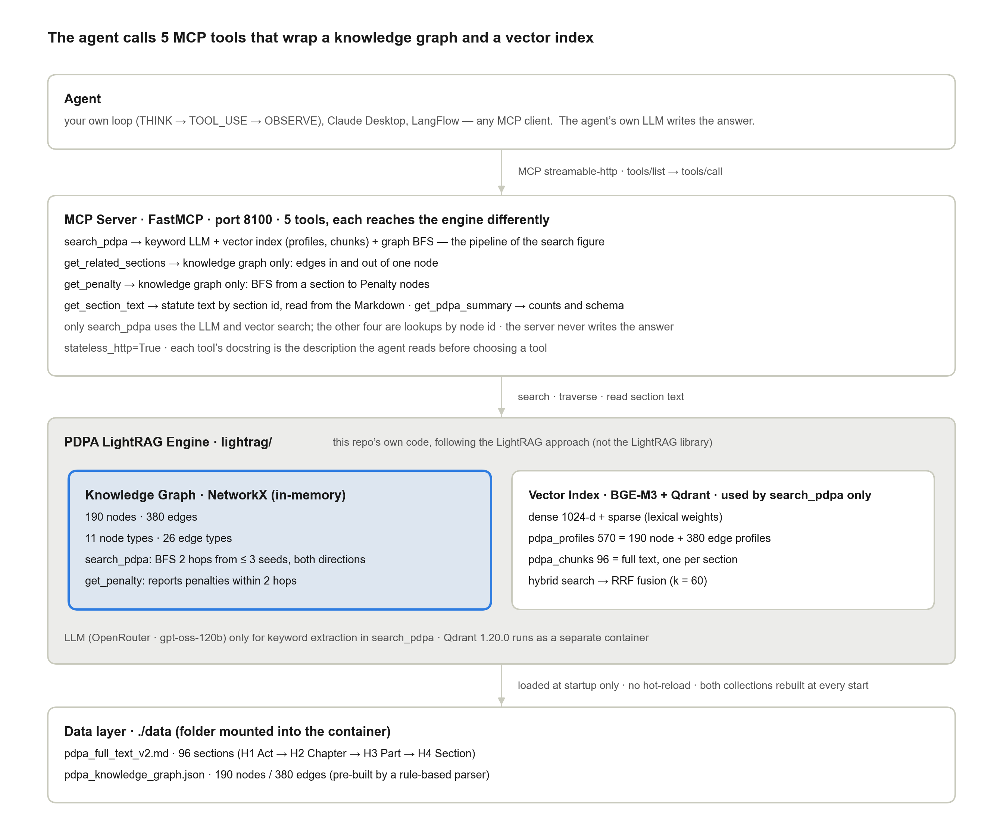
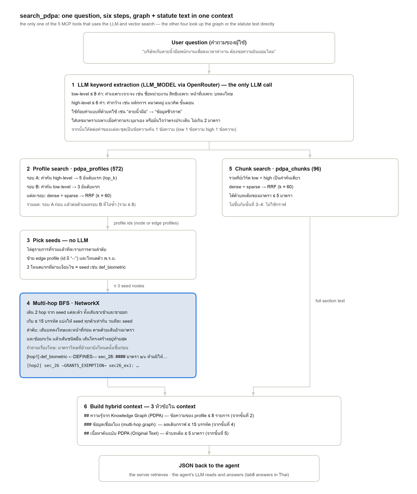

# PDPA GraphRAG + MCP (teaching version, v2)

[ภาษาไทย](README.md)

A GraphRAG agent over Thailand's Personal Data Protection Act (PDPA, B.E. 2562 / 2019).
The 96 sections of the statute become a 190-node / 382-edge knowledge graph plus a dense + sparse
vector index, exposed as five MCP tools that any agent can call. Everything runs locally with
Docker.

This repository is the version used in the GraphRAG course. It continues
[aekanun2020/pdpa-graphrag-mcp](https://github.com/aekanun2020/pdpa-graphrag-mcp), the companion code
for the article series **"Why Vector RAG Answers Only Half of a Legal Question"**, which is now
archived. The original shows the system exactly as the articles describe it; this one fixes the
defects found in a pre-course review (see [What changed from the original](#what-changed-from-the-original)),
so its search results differ from the runs shown in the articles.

Statutes do not repeat themselves, they *point*: a prohibition lives in one section, its exceptions
in sub-clauses, and the penalty chapters later in a sentence that only says "whoever violates
Section 26". Vector search finds the first half; the graph walk finds the second.

The example is Thai law, but the structure is the same for GDPR, HIPAA, the CCPA or Japan's APPI,
and the embedding model is multilingual.

## What changed from the original

| Area | Original | This version |
|---|---|---|
| Fresh image build | Installs mcp 2.x, which removed `FastMCP`; the container crashes at import and restarts in a loop | `mcp[cli]` pinned below 2 |
| `get_section_text` | Read the graph node's `text`, cut at 3,000 characters: Section 26 lost its biometric-data and criminal-record paragraphs | Reads the full section from the Markdown |
| Statute Markdown | 801 split sara-am from PDF extraction ("ก าหนด", "จ าคุก") | Repaired ("กำหนด", "จำคุก"); graph node text is repaired at load time |
| Node profiles | Built from `description` only, which 33 of 190 nodes have; a Section profile held just its id and relation names | Also read `name_th`, `term_th`, `definition`, `title_th` and `text` |
| Section embedding | `max_length=512`; 7 sections are longer (Section 26 is 810 tokens) and lost their tail | `CHUNK_MAX_LENGTH`, default 1024 |
| RRF constant | Not set, so Qdrant's default k = 2 | `RRF_K`, default 60 |
| Result order | RRF scores tie often and Qdrant does not order ties, so the same keywords gave different seeds per call | Fused candidates are sorted by (score, id); the same keywords give the same context |
| Seed selection | Took the top 3 profiles, then dropped edge profiles: possibly no seed at all | Drops edge profiles and the Act node (`PDPA_2562`) first, then takes 3 |
| `build_graph.py` | Truncated section text at 3,000 characters | Preserves all 96 sections, excluding chapter/part headings, closing material and OCR page labels |

The shipped graph and the builder output are byte-for-byte identical, with 190 nodes / 382 edges
and `metadata` computed from the graph. `get_penalty` reports penalties within 2 hops, and graph
expansion in `search_pdpa` contributes at most 15 context lines (see Known limitations).

## What's inside

```
mcp_server_rag.py        FastMCP server (streamable-http, port 8100) exposing 5 tools
lightrag/                retrieval engine: Markdown chunker, NetworkX graph, BGE-M3 + Qdrant index, hybrid retrieval
data/
  pdpa_full_text_v2.md   the statute as Markdown (H1 Act -> H2 Chapter -> H3 Part -> H4 Section)
  pdpa_knowledge_graph.json   pre-built graph: 190 nodes / 382 edges, 11 node types, 26 edge types
scripts/
  build_graph.py         builds the graph with regexes and hand-curated lists; no LLM
  validate_graph.py      counts nodes/edges from the data, checks connectivity and penalty reachability
labs/
  core/                  minimal MCP client (httpx), tool registry (MCP inputSchema -> OpenAI tools), LLM client
  lab8/agent_pdpa_mcp.py an agent loop wired to this MCP server
examples/mcp_curl.sh     talk to the server with plain curl + jq
docs/                    architecture and pipeline figures
Dockerfile, docker-compose.yml, .env.example
requirements.txt, constraints.txt   server libraries and their pinned versions (used when building the image)
requirements-agent.txt              agent-side libraries for running labs/lab8
README.md, LICENSE
```

- [LAB 2 graph](data/pdpa_knowledge_graph.json) and [statute text, all 96 sections](data/pdpa_full_text_v2.md)
- [LAB 3 graph builder](scripts/build_graph.py) and [graph validator](scripts/validate_graph.py)
- [MCP server](mcp_server_rag.py), [Docker Compose](docker-compose.yml), [LAB 8 agent](labs/lab8/agent_pdpa_mcp.py) and [curl smoke test](examples/mcp_curl.sh)
- [Architecture figure](docs/fig1_architecture.png), [search pipeline figure](docs/fig3_search_pipeline.png) and [figure generator](docs/figures/make_figures.py)

`labs/` contains only the agent-side code; the course lab instructions are not part of this repo.

## Architecture



Both figures are drawn by the [Matplotlib script](docs/figures/make_figures.py) and were regenerated
on 18 Nov 2026 to show 190 nodes / 382 edges and Qdrant's 572 profiles / 96 chunks.

- **Knowledge graph**: NetworkX, in memory. 96 Section nodes plus Definition, LawfulBasis, Right,
  Obligation, Penalty, Exemption and Principle nodes; the backbone edges are `REFERENCES_SECTION`
  (124, section cites section) and `CONTAINS_SECTION` (119).
- **Vector index**: BGE-M3 (dense 1024-d + sparse lexical weights) in Qdrant with RRF fusion
  (k = 60, set with `RRF_K`; needs Qdrant server and client 1.16+, otherwise Qdrant's default k = 2 applies).
  Two collections: `pdpa_chunks` (96 chunks, one full section per chunk) and `pdpa_profiles`
  (572 = 190 node profiles + 382 edge profiles). Each profile is a short text that lets vector
  search find graph nodes and relationships.
- **MCP server**: FastMCP, `stateless_http=True`. Each tool's docstring is the description the agent
  reads before choosing a tool.
- **LLM on the server side** (configured by `LLM_MODEL` through OpenRouter; `.env.example` sets it to `gpt-oss-120b`, the model the author uses) is used for exactly one thing, extracting search keywords. Answers are
  written by the agent's own model: *the server retrieves, the agent reasons.*

## Quick start

Requirements: Docker with Compose and an [OpenRouter](https://openrouter.ai) API key.

- **Docker memory:** give Docker at least 8 GB and avoid running other memory-heavy containers next to it.
  Startup peaked at 4.7 GB in our measurement (while embedding the statute text) and settles at about 2.8 GB.
  With too little memory the container is killed during startup (the log shows `Killed`, or the status is
  `Restarting (137)`).
- **Disk:** the built image is about 18 GB as reported by Docker (measured on an ARM Mac with Docker Desktop).
  Most of it is torch and its dependencies, plus BGE-M3 (~2.3 GB), which is baked in at build time so the
  container starts offline.
- **Pinned versions:** `requirements.txt` and `constraints.txt` fix every Python package, the `Dockerfile` uses
  Python 3.11.18 and compose uses Qdrant 1.20.0 — the set the author tested with. (Checked on
  14 Nov 2026 against the earlier 380-edge graph: a fresh build from the repo zip returned search contexts
  identical to the author's when given the same keywords. Not re-checked since the graph changed to 382 edges
  on 18 Nov 2026.) Not pinned: the BGE-M3 weights, downloaded from Hugging Face at build time (tested
  snapshot `5617a9f6`), and system packages from apt.

**The graph ships with the repo:** [`data/pdpa_knowledge_graph.json`](data/pdpa_knowledge_graph.json)
(190 nodes / 382 edges) is in the zip; you do not build it before running. The server loads it at startup
from the `data/` folder mounted into the container. Only the vector index in Qdrant is rebuilt at every
start. `scripts/build_graph.py` (LAB 3) writes to `build/`, so it does not affect the running system.

```bash
cp .env.example .env            # put your OPENROUTER_API_KEY in .env
docker compose up --build       # starts Qdrant + the MCP server; the first build downloads BGE-M3
```

Startup is done when the log shows:

```
Parsed 96 sections (มาตรา), 96 chunks
Upserted 572 profile vectors
Upserted 96 chunk vectors
```

Smoke test with curl (needs `jq`):

```bash
./examples/mcp_curl.sh
```

A bare request without the `Accept: application/json, text/event-stream` header returns
`-32600 Client must accept text/event-stream`. That means the server is alive; the streamable-http
transport simply requires the header.

Run the agent against the server:

```bash
python -m venv .venv && source .venv/bin/activate
pip install -r requirements-agent.txt
python labs/lab8/agent_pdpa_mcp.py "เก็บข้อมูลสุขภาพพนักงานได้ไหม ถ้าฝ่าฝืนมีโทษอะไร"
```

The statute and the agent's system prompt are in Thai, so Thai questions work best (the model
answers in Thai; change `SYSTEM` in `labs/lab8/agent_pdpa_mcp.py` to answer in another language).
The agent uses `deepseek/deepseek-v4.1-flash` through OpenRouter, the `OPENROUTER_MODEL` value in `.env.example`.
Expect the number and order of tool calls to vary between runs: the server-side keyword LLM and the agent's
model are not deterministic. (With the original code a typical run made 7 tool calls in 4 rounds.)

## MCP tools

| Tool | What it does |
|---|---|
| `search_pdpa(query, top_k=5)` | Finds the sections relevant to a question. Always the first tool to call, and the only tool that calls the LLM.<br>**Steps:** LLM extracts keywords -> profile search -> 2-hop BFS -> chunk search -> builds the context<br>**Result:** JSON with the keywords and a `context` for the agent to answer from<br>**Input:** `query` is a question or search phrase in Thai; `top_k` is the number of profiles retrieved with the high-level keywords |
| `get_related_sections(section_id)` | Finds the nodes directly connected to a section in the graph (1 hop). The result is a list of nodes in two groups: nodes this section points to, and nodes that point to this section. Each node comes with its relation type. Use it after `search_pdpa` to find exceptions, rights, duties, penalty sections and the sections to read next.<br>**Input:** a section id, e.g. `sec_26` |
| `get_penalty(section_id)` | Finds the penalties for a violated section by following graph edges from that section, both incoming and outgoing, up to 2 hops. The result is the Penalty nodes found.<br>**Input:** the violated section, e.g. `sec_26`, not the section that sets the penalty |
| `get_section_text(section_id)` | Reads the full text of one section, exactly by the id given, with no semantic search: `sec_27` always returns section 27. Use it before citing a section number or the text of the law in an answer.<br>**Result:** the text of that section from the Markdown file; if no section has that id, `found: false`<br>**Input:** a section id, e.g. `sec_27`; the bare number `27` also works |
| `get_pdpa_summary()` | Gives an overview of the data in the system. Use it to check that the server loaded everything, and for overview questions such as how many sections or chapters the PDPA has.<br>**Result:** total nodes and edges (190 and 382), counts by node type and edge type, and the number of profiles and chunks in the vector index (572 and 96)<br>**Input:** none |

Section ids are `sec_<number>` with Arabic digits (`sec_26`), even though the statute text uses Thai
numerals (มาตรา ๒๖).

## How retrieval works



1. The server-side LLM (configured by `LLM_MODEL`, set to `gpt-oss-120b` in `.env.example`) splits the question into at most 8 low-level keywords (specific terms:
   named rights, duties, penalties) and at most 6 high-level keywords (principles, concepts), after LightRAG's
   dual-level scheme. This is the only step that calls an LLM.
2. Profile search (`pdpa_profiles`, dense + sparse, RRF) runs twice: the high-level query asks for 5 results
   (`top_k`), the low-level query for 3. High-level results come first, followed by low-level results not already
   present, at most 8 in all.
3. Seed selection: walk that list in order, skip edge profiles (ids containing `--`) and the Act node (`PDPA_2562`),
   whose neighbours are only chapters, and take the first 3 nodes left. A skipped node can still appear in the
   context; it is just not a starting point for the graph walk. No LLM is involved.
4. BFS from the seeds, 2 hops, following edges in both directions. At most 15 reached nodes go into the
   context: every seed gets an equal share, penalty and obligation edges come first, then cross-reference and
   exemption edges. When the question or its keywords mention a penalty, sections of the penalty chapter
   that reference a reached node (e.g. `sec_83` referencing `sec_37`) also come first. Finally,
   structural edges (chapter/part) only fill what is left. Each node is written as
   `[hop1] def_biometric ←DEFINES— sec_26: ...`: the left node is where the walk came from and the arrow
   follows the edge's direction in the graph, so the model can read a path from the seed step by step.
5. Chunk search (`pdpa_chunks`) fetches the full text of up to 5 sections, using both keyword levels combined.
   It does not use the graph result.
6. The context is assembled from the three parts (at most 8 profiles, 15 graph lines, 5 full sections) and
   returned as JSON. The server never writes the answer.

## Rebuilding and validating the graph

```bash
python scripts/build_graph.py            # -> build/ (never overwrites data/)
python scripts/validate_graph.py         # checks data/pdpa_knowledge_graph.json
python scripts/validate_graph.py build/pdpa_knowledge_graph.json
```

[`build_graph.py`](scripts/build_graph.py) uses no LLM and needs no API key; it is entirely
rule-based. One regex finds section headings in
[`pdpa_full_text_v2.md`](data/pdpa_full_text_v2.md), and another finds cross-references inside each
section (`REFERENCES_SECTION` edges). Semantic nodes (definitions, rights, obligations, penalties,
exemptions, principles, lawful bases) are curated lists in the script, including the additional
27 exemption nodes, 6 `IS_LAWFUL_BASIS` edges and 4 `REFERENCES_EXEMPTION` edges. The script
builds 190 nodes / 382 edges. `Section.text` ends before the next Markdown heading or the closing
signature and explanatory note. Standalone OCR page labels such as `้หนา ๖๐` are removed before
splitting the sections. Outputs go to `build/` and can be checked with
[`validate_graph.py`](scripts/validate_graph.py).

[`.env.example`](.env.example) has `USE_LLM_EXTRACT` (default `false`), which lets an LLM extract extra nodes
when the server starts. The shipped graph and all labs do not use it.

The LAB 2 graph in [`data/pdpa_knowledge_graph.json`](data/pdpa_knowledge_graph.json) and the LAB 3
output `build/pdpa_knowledge_graph.json` are byte-for-byte identical, including ordering and
`metadata` (190 nodes / 382 edges / 26 edge types). This graph provides 572 profiles, and the
Markdown provides 96 chunks.

To use this on another statute, swap the heading pattern (`Article\s+(\d+)` for GDPR,
`第([一二三四五六七八九十百]+)条` for Japan's APPI) and re-curate the semantic nodes.

## Known limitations

- Built for one statute. The graph lives in memory and both Qdrant collections are rebuilt on every
  start (no hot reload). For a corpus of laws use a graph database; `build_graph.py` also emits
  `pdpa_neo4j_import.cypher`.
- Rule-based graph construction means porting to a new law is curation work, not configuration.
- There is no standard evaluation set yet. Testing so far has been the author's internal testing, with questions
  written during development, and none of it has been reviewed by a lawyer. Contributions of question/answer pairs with expected section
  citations are welcome.
- The shipped graph has a known gap that affects `get_penalty` for one section; it is the subject of
  part 2 of the article series and is left as is until that article is published. Only Sections 77,
  79, 85, 86 and 90 have a Penalty node, so `get_penalty('sec_26')` returns the two criminal
  penalties of Section 79 and no administrative fine.
- The keyword LLM is the remaining source of run-to-run variation: at temperature 0 the same question
  still produced two different keyword sets in four calls, and each set gives its own context.
- The keyword prompt invites the LLM to guess section numbers, and the guesses can be wrong.

## Data

The statute text is the Personal Data Protection Act B.E. 2562 (2019), a public document, prepared
from the version published by the Office of the Council of State of Thailand. The knowledge graph,
code and figures are by the author.

## Article series

Written for the original repository; the runs they show come from the original code.

1. Why Vector RAG Answers Only Half of a Legal Question (Thai: https://aekanunbigdata.medium.com/a0f1e09e3450 — English version coming)
2. One missing edge: why the agent cited the wrong penalty section (coming)
3. Why a GraphRAG agent needs a fifth tool (coming)
