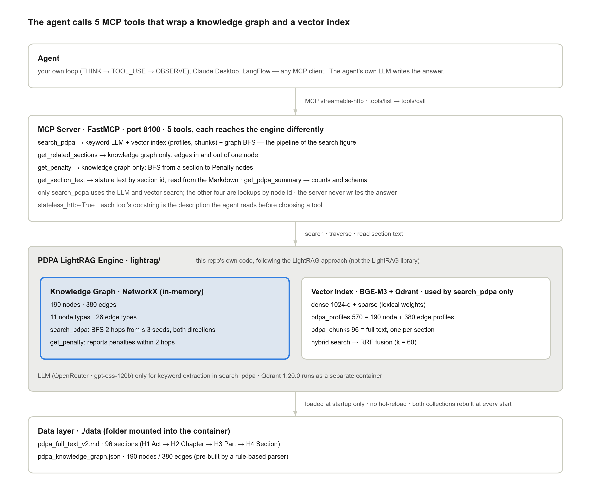
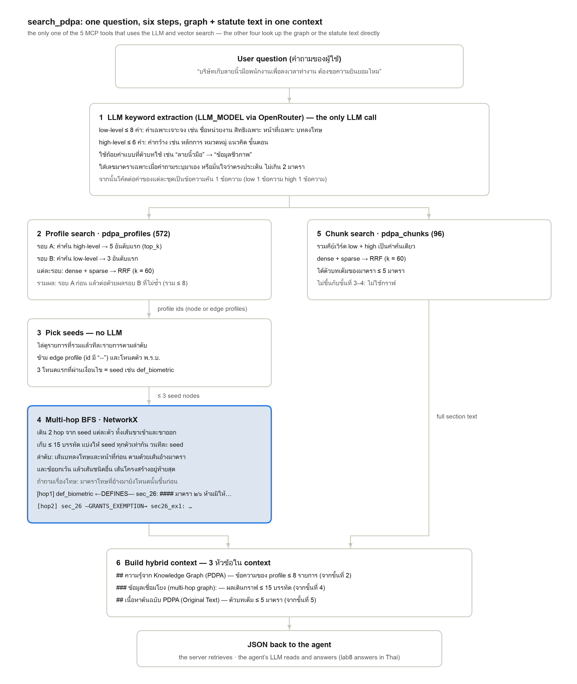

# PDPA GraphRAG + MCP (ฉบับใช้สอน, v2)

[English](README.en.md)

GraphRAG agent สำหรับพระราชบัญญัติคุ้มครองข้อมูลส่วนบุคคล พ.ศ. 2562 (PDPA)
ตัวบท 96 มาตราถูกแปลงเป็น knowledge graph ขนาด 190 โหนด 382 เส้น คู่กับ vector index แบบ dense + sparse
แล้วเปิดให้ agent ใดก็ได้เรียกใช้ผ่าน MCP tool 5 ตัว ทุกอย่างรันบนเครื่องด้วย Docker

repo นี้คือฉบับที่ใช้ในคอร์ส GraphRAG ต่อยอดจาก
[aekanun2020/pdpa-graphrag-mcp](https://github.com/aekanun2020/pdpa-graphrag-mcp)
ซึ่งเป็นโค้ดประกอบบทความชุด **"Why Vector RAG Answers Only Half of a Legal Question"** และถูก archive แล้ว
repo เดิมแสดงระบบตามที่บทความเขียนไว้ทุกประการ ส่วน repo นี้แก้ข้อบกพร่องที่พบจากการทบทวนก่อนสอน
(ดู [สิ่งที่ต่างจาก repo เดิม](#สิ่งที่ต่างจาก-repo-เดิม)) ผลการค้นจึงต่างจากตัวอย่างในบทความ

ตัวบทกฎหมายไม่พูดซ้ำ แต่ใช้วิธี *ชี้ไปหา* ข้อห้ามอยู่ในมาตราหนึ่ง ข้อยกเว้นอยู่ในอนุมาตรา
ส่วนบทลงโทษอยู่ในหมวดท้าย ๆ ในประโยคที่บอกเพียงว่า "ผู้ใดฝ่าฝืนมาตรา 26"
vector search หาครึ่งแรกเจอ การเดินกราฟหาครึ่งหลัง

ตัวอย่างเป็นกฎหมายไทย แต่โครงสร้างเดียวกันใช้ได้กับ GDPR, HIPAA, CCPA หรือ APPI ของญี่ปุ่น
และ embedding model ที่ใช้รองรับหลายภาษา

## สิ่งที่ต่างจาก repo เดิม

| เรื่อง | repo เดิม | repo นี้ |
|---|---|---|
| build image ใหม่ | ติดตั้งได้ mcp 2.x ซึ่งเอา `FastMCP` ออก container ล้มตอน import แล้ววน restart | ตรึง `mcp[cli]` ต่ำกว่า 2 |
| `get_section_text` | อ่าน field `text` ของโหนดในกราฟ ซึ่งถูกตัดที่ 3,000 ตัวอักษร ม.26 จึงขาดวรรคข้อมูลชีวภาพและวรรคประวัติอาชญากรรม | อ่านตัวบทเต็มจาก Markdown |
| ตัวบท Markdown | สระอำแตก 801 แห่งจากการแปลง PDF ("ก าหนด", "จ าคุก") | แก้แล้ว ("กำหนด", "จำคุก") และแก้ตัวบทในกราฟตอนโหลด |
| node profile | สร้างจาก `description` อย่างเดียว ซึ่งมีแค่ 33 จาก 190 โหนด profile ของมาตราจึงมีแค่ id กับชื่อความสัมพันธ์ | อ่าน `name_th`, `term_th`, `definition`, `title_th` และ `text` ด้วย |
| embedding ของมาตรา | `max_length=512` มี 7 มาตราที่ยาวกว่านี้ (ม.26 ยาว 810 token) ส่วนท้ายจึงหาย | `CHUNK_MAX_LENGTH` ค่าเริ่มต้น 1024 |
| ค่า k ของ RRF | ไม่ได้ตั้ง จึงใช้ค่าเริ่มต้นของ Qdrant คือ k = 2 | `RRF_K` ค่าเริ่มต้น 60 |
| ลำดับผลค้น | คะแนน RRF เท่ากันบ่อยและ Qdrant ไม่กำหนดลำดับของคะแนนที่เท่ากัน คีย์เวิร์ดชุดเดิมจึงได้ seed ต่างกันในแต่ละครั้ง | เรียงผลรวมด้วย (คะแนน, id) คีย์เวิร์ดชุดเดิมได้ context เหมือนเดิม |
| การเลือก seed | ตัด profile 3 อันดับแรกก่อน แล้วค่อยทิ้ง edge profile จึงอาจไม่เหลือ seed เลย | ทิ้ง edge profile และโหนดตัว พ.ร.บ. (`PDPA_2562`) ก่อน แล้วค่อยเลือก 3 |
| `build_graph.py` | ตัดตัวบทของมาตราที่ 3,000 ตัวอักษร | เก็บตัวบทครบ 96 มาตรา โดยแยกหัวข้อหมวด/ส่วน ข้อความท้ายกฎหมาย และเลขหน้า OCR ออก |

กราฟสำเร็จรูปและผลจาก builder ตรงกันทั้งไฟล์ มี 190 โหนด / 382 เส้น พร้อม `metadata` ที่นับจากกราฟจริง
`get_penalty` รายงานบทลงโทษภายใน 2 hop ส่วนการขยายกราฟใน `search_pdpa` ให้ context ไม่เกิน 15 บรรทัด
(ดูข้อจำกัดที่ทราบ)

## ใน repo มีอะไรบ้าง

```
mcp_server_rag.py        FastMCP server (streamable-http, port 8100) เปิด tool 5 ตัว
lightrag/                retrieval engine: ตัด Markdown, กราฟ NetworkX, index BGE-M3 + Qdrant, hybrid retrieval
data/
  pdpa_full_text_v2.md   ตัวบทในรูป Markdown (H1 พ.ร.บ. -> H2 หมวด -> H3 ส่วน -> H4 มาตรา)
  pdpa_knowledge_graph.json   กราฟสำเร็จรูป: 190 โหนด / 382 เส้น, โหนด 11 ประเภท, เส้น 26 ประเภท
scripts/
  build_graph.py         สร้างกราฟด้วย regex และรายการที่คัดเลือกด้วยมือ ไม่ใช้ LLM
  validate_graph.py      นับโหนด/เส้นจากข้อมูลจริง ตรวจการเชื่อมต่อและการเดินไปถึงบทลงโทษ
labs/
  core/                  MCP client ขนาดเล็ก (httpx), tool registry (MCP inputSchema -> OpenAI tools), LLM client
  lab8/agent_pdpa_mcp.py agent loop ที่ต่อเข้ากับ MCP server นี้
examples/mcp_curl.sh     คุยกับ server ด้วย curl + jq
docs/                    รูปสถาปัตยกรรมและ pipeline
Dockerfile, docker-compose.yml, .env.example
requirements.txt, constraints.txt   ไลบรารีของ server และรุ่นที่ตรึงไว้ (ใช้ตอน build image)
requirements-agent.txt              ไลบรารีฝั่ง agent สำหรับรัน labs/lab8
README.en.md, LICENSE
```

- [กราฟสำหรับ LAB 2](data/pdpa_knowledge_graph.json) และ [ตัวบท 96 มาตรา](data/pdpa_full_text_v2.md)
- [ตัวสร้างกราฟสำหรับ LAB 3](scripts/build_graph.py) และ [ตัวตรวจกราฟ](scripts/validate_graph.py)
- [MCP server](mcp_server_rag.py), [Docker Compose](docker-compose.yml), [agent ของ LAB 8](labs/lab8/agent_pdpa_mcp.py) และ [ทดสอบด้วย curl](examples/mcp_curl.sh)
- [ภาพสถาปัตยกรรม](docs/fig1_architecture.png), [ภาพขั้นตอนค้น](docs/fig3_search_pipeline.png) และ [สคริปต์สร้างภาพ](docs/figures/make_figures.py)
- [บันทึกการแก้สไลด์ M1–M2 และผลรัน LAB 4 วันที่ 20 พ.ย. 2569](docs/slide-fixes-2026-11-20.md)

`labs/` มีเฉพาะโค้ดฝั่ง agent เอกสารประกอบ lab ของคอร์สไม่ได้อยู่ใน repo นี้

## สถาปัตยกรรม



- **Knowledge graph**: NetworkX อยู่ในหน่วยความจำ มีโหนด Section 96 โหนด และโหนด Definition, LawfulBasis,
  Right, Obligation, Penalty, Exemption, Principle เส้นหลักคือ `REFERENCES_SECTION`
  (124 เส้น มาตราอ้างถึงมาตรา) และ `CONTAINS_SECTION` (119 เส้น)
- **Vector index**: BGE-M3 (dense 1024 มิติ + sparse แบบ lexical weights) ใน Qdrant รวมผลด้วย RRF
  (k = 60 ตั้งได้ด้วย `RRF_K` ต้องใช้ Qdrant server และ client รุ่น 1.16 ขึ้นไป ถ้าต่ำกว่านั้นจะใช้ค่าเริ่มต้นของ Qdrant คือ k = 2)
  มีสอง collection คือ `pdpa_chunks` (96 chunks จากตัวบทเต็ม 96 มาตรา มาตราละหนึ่ง chunk)
  และ `pdpa_profiles` (572 รายการ = 190 node profiles + 382 edge profiles)
  แต่ละ profile เขียนเป็นข้อความสั้น ๆ เพื่อให้ vector search ค้นเจอโหนดและความสัมพันธ์ในกราฟได้
- **MCP server**: FastMCP, `stateless_http=True` docstring ของแต่ละ tool คือคำอธิบายที่ agent อ่านก่อนเลือกใช้
- **LLM ฝั่ง server** (กำหนดด้วย `LLM_MODEL` ผ่าน OpenRouter ค่าใน `.env.example` ที่ผู้เขียนใช้คือ `gpt-oss-120b`) ใช้ทำอย่างเดียว คือแตกคีย์เวิร์ดสำหรับค้น คำตอบเขียนโดยโมเดลของ agent เอง:
  *server ค้น ส่วน agent คิดและตอบ*

รูปทั้งสองสร้างด้วย [สคริปต์ Matplotlib](docs/figures/make_figures.py) และเรนเดอร์ใหม่วันที่ 18 พ.ย. 2569
ให้ตรงกับกราฟ 190 โหนด / 382 เส้น และ Qdrant 572 profiles / 96 chunks

## เริ่มใช้งาน

สิ่งที่ต้องมี: Docker พร้อม Compose และ API key ของ [OpenRouter](https://openrouter.ai)

- **หน่วยความจำของ Docker:** ตั้งไว้อย่างน้อย 8 GB และไม่ควรมี container อื่นที่ใช้หน่วยความจำมากรันอยู่ด้วย
  ตอนเริ่ม server ใช้สูงสุดที่วัดได้ 4.7 GB (ช่วง embed ตัวบท) แล้วลดลงเหลือราว 2.8 GB ตอนทำงานปกติ
  ถ้าหน่วยความจำไม่พอ container จะถูก kill ระหว่างเริ่ม (log ขึ้น `Killed` หรือสถานะ `Restarting (137)`)
- **พื้นที่ดิสก์:** image ที่ build แล้วมีขนาดราว 18 GB ตามที่ Docker รายงาน (วัดบน Mac ชิป ARM, Docker Desktop)
  ส่วนใหญ่เป็น torch กับไลบรารีที่ติดมา และ BGE-M3 ราว 2.3 GB ที่ถูกใส่ไว้ใน image ตอน build
  container จึงเริ่มได้โดยไม่ต้องต่ออินเทอร์เน็ต
- **รุ่นที่ตรึงไว้:** `requirements.txt` กับ `constraints.txt` ตรึงรุ่นไลบรารี Python ทุกตัว `Dockerfile` ใช้ Python 3.11.18
  และ compose ใช้ Qdrant 1.20.0 เป็นชุดที่ผู้เขียนใช้ทดสอบ (ตรวจเมื่อ 14 พ.ย. 2569 กับกราฟรุ่นก่อน
  ซึ่งมี 380 เส้น: build ใหม่จาก zip ของ repo ได้ผลค้นตรงกับเครื่องของผู้เขียนทุกตัวอักษรเมื่อใช้คีย์เวิร์ดชุดเดียวกัน
  ยังไม่ได้ตรวจซ้ำหลังแก้กราฟเป็น 382 เส้นเมื่อ 18 พ.ย. 2569) สิ่งที่ไม่ได้ตรึงคือน้ำหนักของ BGE-M3
  ซึ่งดาวน์โหลดจาก Hugging Face ตอน build (รุ่นที่ทดสอบคือ snapshot `5617a9f6`) และแพ็กเกจของระบบจาก apt

**กราฟมากับ repo แล้ว:** [`data/pdpa_knowledge_graph.json`](data/pdpa_knowledge_graph.json) (190 โหนด / 382 เส้น)
อยู่ใน zip ไม่ต้องสร้างก่อนรัน server โหลดไฟล์นี้ตอนเริ่มผ่านโฟลเดอร์ `data/` ที่ mount เข้า container
สิ่งที่สร้างใหม่ทุกครั้งที่เริ่มคือ vector index ใน Qdrant เท่านั้น ส่วน `scripts/build_graph.py` (LAB 3)
เขียนผลลง `build/` จึงไม่กระทบระบบที่รันอยู่

```bash
cp .env.example .env            # ใส่ OPENROUTER_API_KEY ใน .env
docker compose up --build       # เริ่ม Qdrant + MCP server; build ครั้งแรกจะดาวน์โหลด BGE-M3
```

ระบบพร้อมเมื่อ log แสดง:

```
Parsed 96 sections (มาตรา), 96 chunks
Upserted 572 profile vectors
Upserted 96 chunk vectors
```

ถ้า log แสดง `RRF k=60 ใช้ไม่ได้` แปลว่า Qdrant บนเครื่องเก่ากว่า 1.16 ระบบยังทำงานได้ด้วย k = 2

ทดสอบเบื้องต้นด้วย curl (ต้องมี `jq`):

```bash
./examples/mcp_curl.sh
```

request ที่ไม่มี header `Accept: application/json, text/event-stream` จะได้
`-32600 Client must accept text/event-stream` กลับมา แปลว่า server ทำงานอยู่
transport แบบ streamable-http บังคับให้มี header นี้

รัน agent ต่อเข้ากับ server:

```bash
python -m venv .venv && source .venv/bin/activate
pip install -r requirements-agent.txt
python labs/lab8/agent_pdpa_mcp.py "เก็บข้อมูลสุขภาพพนักงานได้ไหม ถ้าฝ่าฝืนมีโทษอะไร"
```

ตัวบทและ system prompt ของ agent เป็นภาษาไทย คำถามภาษาไทยจึงได้ผลดีที่สุด
(ถ้าต้องการให้ตอบภาษาอื่น แก้ `SYSTEM` ใน `labs/lab8/agent_pdpa_mcp.py`)
agent ใช้โมเดล `deepseek/deepseek-v4.1-flash` ผ่าน OpenRouter ตามค่า `OPENROUTER_MODEL` ใน `.env.example`
จำนวนและลำดับการเรียก tool ต่างไปได้ในแต่ละรอบ เพราะคีย์เวิร์ดจาก LLM ฝั่ง server และคำตอบของโมเดลฝั่ง agent ไม่คงที่
(กับโค้ดของ repo เดิม การรันทั่วไปเรียก tool 7 ครั้งใน 4 รอบ)

## MCP tools

| Tool | ทำอะไร |
|---|---|
| `search_pdpa(query, top_k=5)` | Hybrid retrieval: LLM แตกคีย์เวิร์ด -> ค้น profile -> BFS 2 hop -> ค้น chunk -> context (JSON) |
| `get_related_sections(section_id)` | เส้นขาเข้าและขาออกของมาตราหนึ่ง แยกตามชนิดความสัมพันธ์ |
| `get_penalty(section_id)` | BFS สองทิศจากมาตราที่ถูกฝ่าฝืนไปหาโหนด Penalty รายงานโหนด Penalty ที่อยู่ห่างไม่เกิน 2 hop (ลูปหยุดที่ hop 3 ก่อนบันทึกผล) ให้ส่งมาตราที่ถูกฝ่าฝืน (`sec_26`) ไม่ใช่มาตราโทษ |
| `get_section_text(section_id)` | อ่านตัวบทเต็มของมาตราจาก Markdown ตาม id แบบกำหนดแน่นอน โดยค้นหามาตราตรงตาม id |
| `get_pdpa_summary()` | จำนวนโหนด/เส้น และ schema ของกราฟ |

id ของมาตราใช้รูป `sec_<เลข>` ด้วยเลขอารบิก (`sec_26`) แม้ตัวบทจะใช้เลขไทย (มาตรา ๒๖)

## การค้นทำงานอย่างไร



1. LLM ฝั่ง server (กำหนดด้วย `LLM_MODEL` ซึ่ง `.env.example` ตั้งเป็น `gpt-oss-120b`) แยกคำถามเป็นคีย์เวิร์ด low-level ไม่เกิน 8 คำ (คำเฉพาะ เช่น ชื่อสิทธิ หน้าที่ บทลงโทษ)
   และ high-level ไม่เกิน 6 คำ (หลักการ แนวคิด) ตามแนวทาง dual-level ของ LightRAG ขั้นนี้เป็นจุดเดียวที่เรียก LLM
2. ค้น profile (`pdpa_profiles`, dense + sparse, RRF) สองรอบ: รอบ high-level ขอ 5 รายการ (`top_k`) และรอบ low-level ขอ 3 รายการ
   นำผลรอบ high-level ขึ้นก่อน แล้วต่อด้วยผลรอบ low-level ที่ยังไม่ซ้ำ ได้ไม่เกิน 8 รายการ
3. เลือก seed: ไล่รายการตามลำดับ ข้าม profile ของเส้น (id มี `--`) และโหนดตัว พ.ร.บ. (`PDPA_2562`) เพราะเพื่อนบ้านมีแต่หมวด
   แล้วหยิบ 3 โหนดแรกที่เหลือ โหนดที่ถูกข้ามยังแสดงใน context ได้ตามปกติ แค่ไม่ใช้เป็นจุดเริ่มเดินกราฟ ขั้นนี้ไม่มี LLM
4. BFS จาก seed 2 hop ตามเส้นทั้งสองทิศ แล้วเลือกไม่เกิน 15 โหนดลง context โดยแบ่งโควตาให้ทุก seed เท่ากัน
   ให้เส้นบทลงโทษและเส้นหน้าที่มาก่อน ตามด้วยการอ้างข้ามมาตรา และข้อยกเว้น เมื่อคำถามหรือคีย์เวิร์ดมีคำเรื่องโทษ มาตราในหมวดบทกำหนดโทษที่อ้างมายังโหนดที่เดินถึง (เช่น `sec_83` ที่อ้าง `sec_37`) ได้ลำดับแรกด้วย ส่วนเส้นโครงสร้าง (หมวด/ส่วน) ได้ที่เฉพาะเมื่อเหลือโควตา
   แต่ละโหนดถูกเขียนเป็น `[hop1] def_biometric ←DEFINES— sec_26: ...` โหนดซ้ายคือโหนดที่เดินมาจาก
   และลูกศรชี้ตามทิศของเส้นในกราฟ โมเดลจึงอ่านเส้นทางจาก seed ต่อกันเป็นทอด ๆ ได้
5. ค้น chunk (`pdpa_chunks`) ด้วยคีย์เวิร์ดสองระดับรวมกัน ได้ตัวบทเต็มไม่เกิน 5 มาตรา
   ขั้นนี้ไม่ใช้ผลจากกราฟ
6. ประกอบ context จากสามส่วน (profile ไม่เกิน 8 รายการ, ผลเดินกราฟไม่เกิน 15 บรรทัด, ตัวบทเต็มไม่เกิน 5 มาตรา) แล้วส่งกลับเป็น JSON
   server ไม่เขียนคำตอบ

## สร้างและตรวจกราฟใหม่

```bash
python scripts/build_graph.py            # -> build/ (ไม่เขียนทับ data/)
python scripts/validate_graph.py         # ตรวจ data/pdpa_knowledge_graph.json
python scripts/validate_graph.py build/pdpa_knowledge_graph.json
```

[`build_graph.py`](scripts/build_graph.py) ไม่ใช้ LLM และไม่ต้องมี API key ทำงานด้วยกฎทั้งหมด: regex ตัวหนึ่งหาหัวมาตราใน
[`pdpa_full_text_v2.md`](data/pdpa_full_text_v2.md) อีกตัวหาการอ้างข้ามมาตรา
(เส้น `REFERENCES_SECTION`) ส่วนโหนดเชิงความหมาย (นิยาม สิทธิ หน้าที่ บทลงโทษ ข้อยกเว้น หลักการ ฐานทางกฎหมาย)
เป็นรายการที่คัดเลือกไว้ในสคริปต์ รวมข้อยกเว้นเพิ่มเติม 27 โหนด เส้น `IS_LAWFUL_BASIS` 6 เส้น
และ `REFERENCES_EXEMPTION` 4 เส้น สคริปต์นี้สร้างกราฟ 190 โหนด / 382 เส้น
`Section.text` สิ้นสุดก่อนหัวข้อ Markdown ถัดไป หรือก่อนข้อความลงนามและหมายเหตุท้ายกฎหมาย
บรรทัดเลขหน้า OCR รูปแบบ `้หนา ๖๐` จะถูกลบก่อนตัดข้อความของแต่ละมาตรา
ผลสร้างใหม่อยู่ใน `build/` และตรวจได้ด้วย [`validate_graph.py`](scripts/validate_graph.py)
ไฟล์ [`data/pdpa_knowledge_graph.json`](data/pdpa_knowledge_graph.json) สำหรับ LAB 2 และ
`build/pdpa_knowledge_graph.json` จาก LAB 3 ตรงกันทุกไบต์ รวมลำดับข้อมูลและ `metadata`
ซึ่งระบุ 190 โหนด / 382 เส้น / เส้น 26 ประเภท กราฟนี้ให้ 572 profiles และ Markdown ให้ 96 chunks

ใน [`.env.example`](.env.example) มี `USE_LLM_EXTRACT` (ค่าเริ่มต้น `false`) สำหรับให้ LLM สกัดโหนดเพิ่มตอน server เริ่มทำงาน
กราฟที่ให้มาและทุก LAB ไม่ได้ใช้ทางนี้

ถ้าจะใช้กับกฎหมายฉบับอื่น ให้เปลี่ยน pattern ของหัวข้อ (`Article\s+(\d+)` สำหรับ GDPR,
`第([一二三四五六七八九十百]+)条` สำหรับ APPI ของญี่ปุ่น) แล้วคัดเลือกโหนดเชิงความหมายใหม่

## ข้อจำกัดที่ทราบ

- สร้างมาสำหรับกฎหมายฉบับเดียว กราฟอยู่ในหน่วยความจำ และ collection ทั้งสองของ Qdrant ถูกสร้างใหม่ทุกครั้งที่เริ่ม
  (ไม่มี hot reload) ถ้าเป็นคลังกฎหมายหลายฉบับควรใช้ graph database `build_graph.py` สร้างไฟล์
  `pdpa_neo4j_import.cypher` ไว้ให้ด้วย
- การสร้างกราฟด้วยกฎแปลว่าการย้ายไปใช้กับกฎหมายใหม่เป็นงานคัดเลือกข้อมูล ไม่ใช่แค่การตั้งค่า
- ยังไม่มีชุดประเมินผลมาตรฐาน การทดสอบที่ทำมาเป็นการทดสอบภายในของผู้เขียน ด้วยชุดคำถามที่เขียนขึ้นระหว่างการพัฒนา
  และยังไม่ผ่านการตรวจโดยนักกฎหมาย
- กราฟที่ให้มามีช่องโหว่ที่ทราบอยู่แล้วซึ่งกระทบ `get_penalty` ของมาตราหนึ่ง เป็นหัวข้อของบทความตอนที่ 2
  และคงไว้ตามเดิมจนกว่าบทความนั้นจะเผยแพร่ มีเพียงมาตรา 77, 79, 85, 86 และ 90 ที่มีโหนด Penalty
  ดังนั้น `get_penalty('sec_26')` คืนโทษอาญา 2 รายการของมาตรา 79 และไม่มีโทษปรับทางปกครอง
- ความไม่คงที่ระหว่างการรันที่เหลืออยู่มาจาก LLM แตกคีย์เวิร์ด: ที่ temperature 0 คำถามเดียวกันยังได้คีย์เวิร์ด
  2 ชุดจากการเรียก 4 ครั้ง และแต่ละชุดให้ context ของตัวเอง
- prompt แตกคีย์เวิร์ดชวนให้ LLM เดาเลขมาตรา ซึ่งเดาผิดได้

## ข้อมูล

ตัวบทคือพระราชบัญญัติคุ้มครองข้อมูลส่วนบุคคล พ.ศ. 2562 ซึ่งเป็นเอกสารสาธารณะ
จัดเตรียมจากฉบับที่เผยแพร่โดยสำนักงานคณะกรรมการกฤษฎีกา knowledge graph โค้ด และรูปเป็นของผู้เขียน

## บทความชุด

เขียนสำหรับ repo เดิม ตัวอย่างการรันในบทความมาจากโค้ดเดิม

1. Why Vector RAG Answers Only Half of a Legal Question (ภาษาไทย: https://aekanunbigdata.medium.com/a0f1e09e3450)
2. One missing edge: why the agent cited the wrong penalty section (ยังไม่เผยแพร่)
3. Why a GraphRAG agent needs a fifth tool (ยังไม่เผยแพร่)
